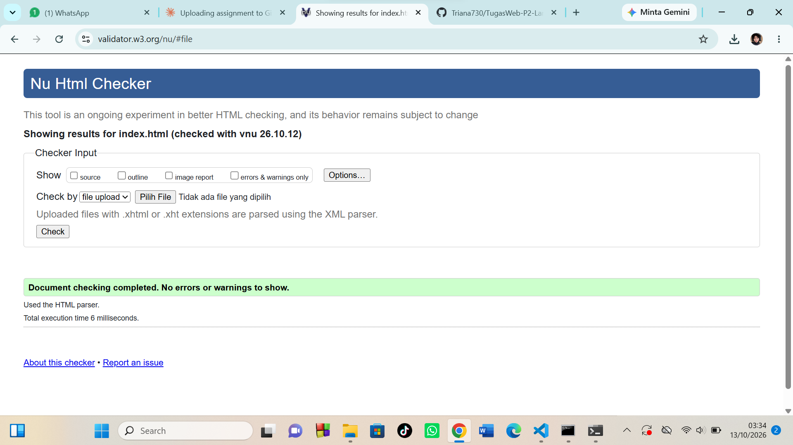

# Tugas Rutin 2 — Landing Page Pribadi dengan CSS

Landing page pribadi berbasis HTML5 semantik yang di-styling menggunakan CSS,
dibuat untuk mata kuliah Pemrograman Web, UNIMED.

## Fitur
- Struktur semantik: header, nav, main, article, section, aside, footer
- Form interaktif dengan validasi
- Gambar dengan alt dan figcaption
- Heading hierarkis (h1 → h2 → h3)
- Meta tags SEO (title, description, viewport)
- Styling menggunakan file CSS eksternal (`style.css`)
- Lolos validasi W3C (HTML dan CSS)

## Struktur Folder
- `index.html` — halaman utama
- `style.css` — styling halaman
- file gambar (`.jpg` / `.jpeg`) — aset gambar

## Cara Menjalankan
1. Clone repo ini
2. Buka file `index.html` di browser

## Screenshot

## Pembuat
Selvira
